# ha-pronote-card

[](https://www.home-assistant.io/integrations/marketplace/)
[](https://github.com/juju35/ha-pronote-card/actions/workflows/hacs.yml)
[](https://github.com/juju35/ha-pronote-card/actions/workflows/validate.yml)
[](https://github.com/juju35/ha-pronote-card/actions/workflows/lint.yml)
[](https://github.com/juju35/ha-pronote-card/releases/latest)
[](https://github.com/juju35/ha-pronote-card/blob/main/LICENSE)
[](https://buymeacoffee.com/julienstep9)

Lovelace cards for Home Assistant showing the school life of your children from **Pronote**, the school management software used by French schools: today's and the next school day's **timetable** (canceled and changed lessons stand out), **homework** (done or to do), latest **grades** and **averages**, **evaluations** and **school life** (absences, late arrivals, punishments, menus, information), for one or several students.

The cards work on top of the community [Pronote integration](https://github.com/delphiki/hass-pronote). Entities are **discovered automatically** from the Home Assistant registries: every Pronote account is a student, you don't pick its sensors one by one, and it works whatever your Home Assistant language or entity ids.

[](https://my.home-assistant.io/redirect/marketplace_repository/?owner=juju35&repository=ha-pronote-card&category=plugin)

| Pronote Card | Pronote Mini Card |
|---|---|
| 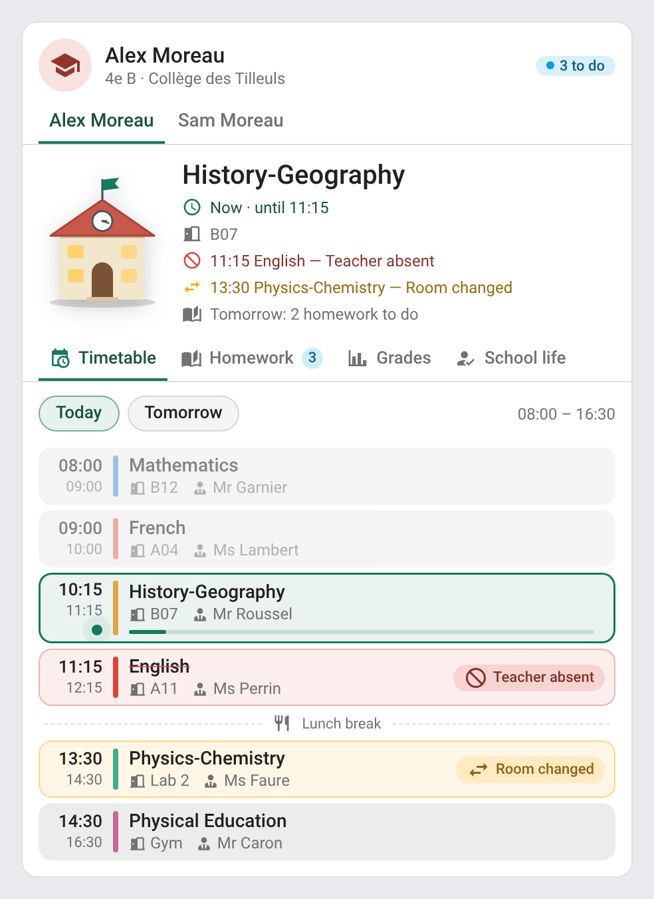 | 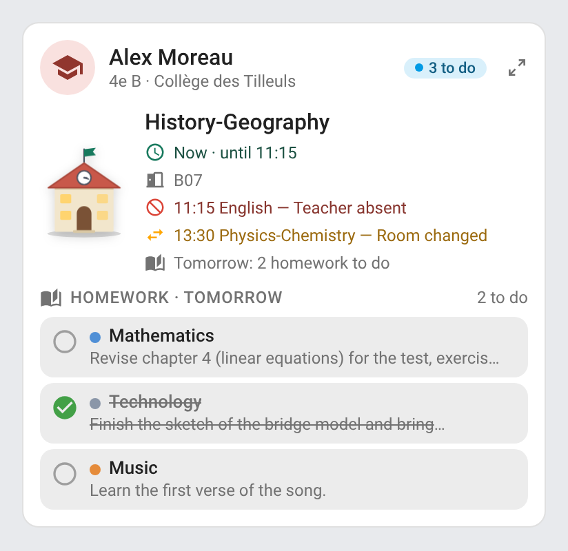<br>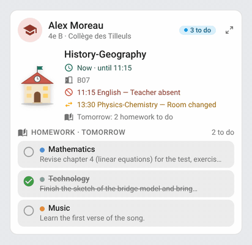 |

## Features

- Two cards: a full **Pronote Card** (`custom:pronote-card`) and a compact **Pronote Mini Card** (`custom:pronote-mini-card`)
- **Several students** (one Pronote account each, parent accounts included): one text tab per student, the header naming the one shown; or pick them with `device` / `devices`
- Header icon in a tinted round badge, red when a lesson of the day is canceled, orange when one has changed; status chip with the homework still to do
- Animated picture of the school, following the day: lesson going on, lesson canceled, homework to do, homework done (see [Animations](#animations)); beside it the lesson going on or the next one, the canceled and changed lessons still to come and the homework for the next school day
- **Timetable** tab: today and the next school day, the lesson going on with a pulsing dot and its progress, past lessons dimmed, **canceled lessons struck through in red**, **changed lessons in orange** with Pronote's own status ("Teacher absent", "Room changed"…), tests, outings and detentions tagged, the lunch break between the morning and the afternoon, rooms and teachers
- **Homework** tab: grouped by due day, a check circle for the homework done and an empty one for the homework to do, the subject in its Pronote color; a click opens the full text and the attachments in a popup at the top of the card
- **Grades** tab: overall average of the period, latest grades on their own scale (out of 20, 10…) with the class average, averages per subject with a bar and the class marker, evaluations with their acquisition levels
- **School life** tab: counters (absences, late arrivals, punishments, unread information), absences and late arrivals justified or not, punishments, today's menu, the school's information with the unread ones marked
- Collapsible sections (chevron to the right when folded, down when unfolded), folded back by a click elsewhere on the page
- Mini card: next lesson, the changes of the day still to come and the homework for the next school day; the detail button (top right) switches it to the full card's content and back, a click anywhere outside the card brings the compact view back
- Click any value to open its Home Assistant history (more-info dialog)
- Visual editor in the dashboard UI for both cards (no YAML needed)
- Light and dark mode, 22 languages (see [Translations](#translations))
- Single file, no external dependency

## Supported integrations

| Integration | What the cards show |
|---|---|
| [Pronote](https://github.com/delphiki/hass-pronote) (custom, `pronote`) — and its forks keeping the `pronote` domain | Everything: class and school, today's / tomorrow's / next day's timetable, homework, grades, averages, overall average and period, evaluations, absences, late arrivals, punishments, menus, information and surveys |

The cards read the sensors of the current period (`lessons_today`, `lessons_tomorrow`, `lessons_next_day`, `homework`, `grades`, `averages`, `overall_average`, `evaluations`, `absences`, `delays`, `punishments`, `menus`, `information_and_surveys`, `class`, `current_period`); the sensors of past periods are left out. Versions of the integration older than its translated entity names are recognized from their entity ids (`sensor.pronote_<student>_timetable_today`…). A sensor the integration does not create (menus at a school without a canteen, evaluations…) simply hides its part of the card.

> [!NOTE]
> Pronote gives no way to tick a homework from Home Assistant: the cards show it as done or to do as Pronote reports it (ticked in the Pronote app).

## Prerequisites

Home Assistant 2024.8 or later, with the [Pronote integration](https://github.com/delphiki/hass-pronote) configured for at least one student.

## Installation

### Via the Marketplace (recommended)

Click the button below to add the repository directly:

[](https://my.home-assistant.io/redirect/marketplace_repository/?owner=juju35&repository=ha-pronote-card&category=plugin)

Then click **Install**, and reload your browser when the Marketplace asks you to.

Or manually:

1. Open **Settings → Marketplace → Add from link** (top right; this needs a GitHub account connected)
2. Add `https://github.com/juju35/ha-pronote-card` — Type: **Dashboard**
3. Open **Pronote Card** and click **Install**
4. Check that **Settings → Dashboards → ⋮ → Resources** lists `/local/community/ha-pronote-card/pronote-card.js`, then clear your browser cache and refresh

### Manual

1. Download `pronote-card.js` and the `pronote-card.i18n.*.js` translation files from the [latest release](https://github.com/juju35/ha-pronote-card/releases/latest)
2. Copy them all to `/config/www/` (without the translation files, the cards show in English)
3. Go to **Settings → Dashboards → ⋮ → Resources** → Add resource:
   - URL: `/local/pronote-card.js`
   - Type: **JavaScript Module**
4. Clear your browser cache and refresh

## Configuration

### Card types

| Card | Type |
|---|---|
| Pronote Card | `custom:pronote-card` |
| Pronote Mini Card | `custom:pronote-mini-card` |

### Visual editor

Edit a dashboard, click **Add card** and search for **Pronote Card** or **Pronote Mini Card**. All students are shown by default; pick some of them (full card) or one (mini card) in the list, choose the tabs and their order, the default tab, the sections folded by default, what to show, and the language. The preview updates live, and options left at their default are kept out of the generated YAML.

### Minimal

```yaml
type: custom:pronote-card
```

```yaml
type: custom:pronote-mini-card
```

### Full options

```yaml
type: custom:pronote-card
devices:
  - Alex Moreau
  - Sam Moreau
tabs:
  - timetable
  - homework
  - grades
  - school_life
default_tab: timetable
show_title: true
show_subtitle: true
show_picture: true
show_room: true
show_teacher: true
show_canceled: true
show_done_homework: true
show_class_average: true
max_grades: 5
collapsed:
  - evaluations
  - information
language: fr
```

```yaml
type: custom:pronote-mini-card
device: Alex Moreau
title: Alex
show_picture: true
show_room: true
zoom: true
language: fr
```

### Options reference

| Option | Card | Default | Description |
|---|---|---|---|
| `device` | both | All students | One student: its name (the nickname set in the integration, its full name, or the device name `Pronote - …`) or its device id |
| `devices` | both | All students | Several students, in the order of their tabs (set by the visual editor of the full card) |
| `title` | both | Student name | Card title, when the card shows one student |
| `show_title` | both | `true` | Show the title in the header (e.g. `false` under a section heading of your own) |
| `show_subtitle` | both | `true` | Show the class and the school under the title |
| `show_picture` | both | `true` | Show the animated picture of the school |
| `show_room` | both | `true` | Show the rooms of the lessons |
| `show_teacher` | full | `true` | Show the teachers of the lessons |
| `show_canceled` | full | `true` | Show the canceled lessons in the timetable (they stay in the alerts beside the picture) |
| `tabs` | full | all four | Tabs shown, in this order, among `timetable`, `homework`, `grades` and `school_life` (one tab only: no tab bar) |
| `default_tab` | full | `timetable` | Tab shown when the card opens |
| `show_done_homework` | full | `true` | Show the homework already done (checked) in the Homework tab |
| `show_class_average` | full | `true` | Show the class average of each grade and the class marker on the averages |
| `max_grades` | full | `5` | Number of latest grades shown (the integration keeps 11) |
| `collapsed` | full | `[evaluations, information]` | Sections folded by default, among `grades`, `averages`, `evaluations`, `absences`, `delays`, `punishments`, `menus` and `information` (`[]` to unfold everything). Click a section title (or Tab to it and press Enter or Space) to fold or unfold it; a click elsewhere on the page folds them back |
| `zoom` | mini | `true` | Detail button at the top right of the mini card: it shows the full card's content (with the same options, so `tabs`, `collapsed`… can be set on the mini card too) and switches back to the compact view; a click outside the card also brings the compact view back. `false` removes the button |
| `language` | both | Auto | Force language: `fr`, `en`, `de`, `es`, `sr`, `sr-Latn`, `it`, `nl`, `pt`, `pl`, `ro`, `da`, `sv`, `bg`, `ru`, `uk`, `hu`, `sk`, `cs`, `sl`, `lv` or `el` (auto-detects from HA settings) |

## Screenshots

All screenshots use made-up students, schools and teachers, with the clock set on a Tuesday at 10:20.

### Timetable

Today, with the lesson going on (pulsing dot and progress bar), English canceled (the teacher is absent) and Physics-Chemistry in another room; the next school day, with a test:

| Light | Dark |
|---|---|
|  | 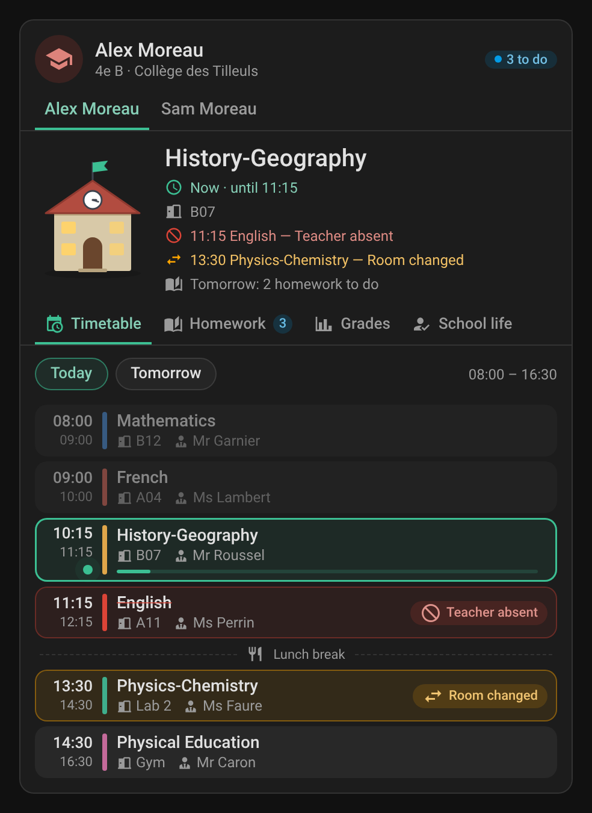 |
| 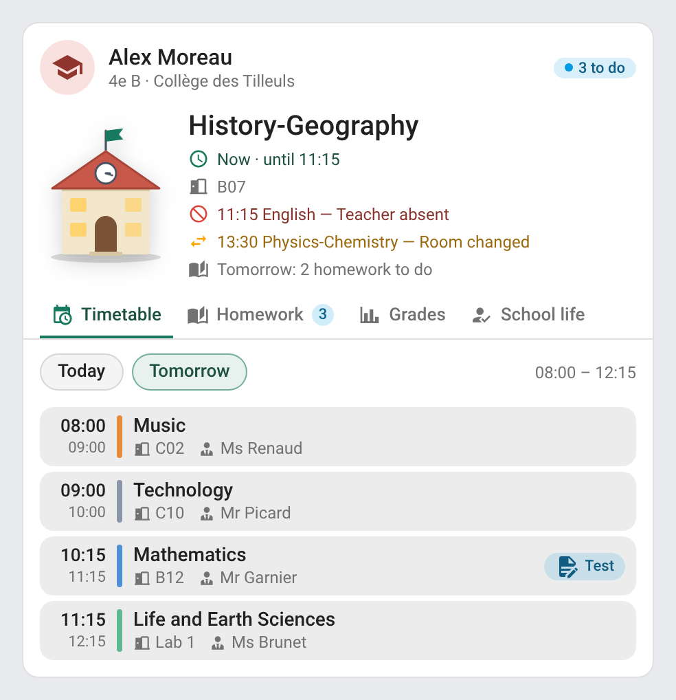 | 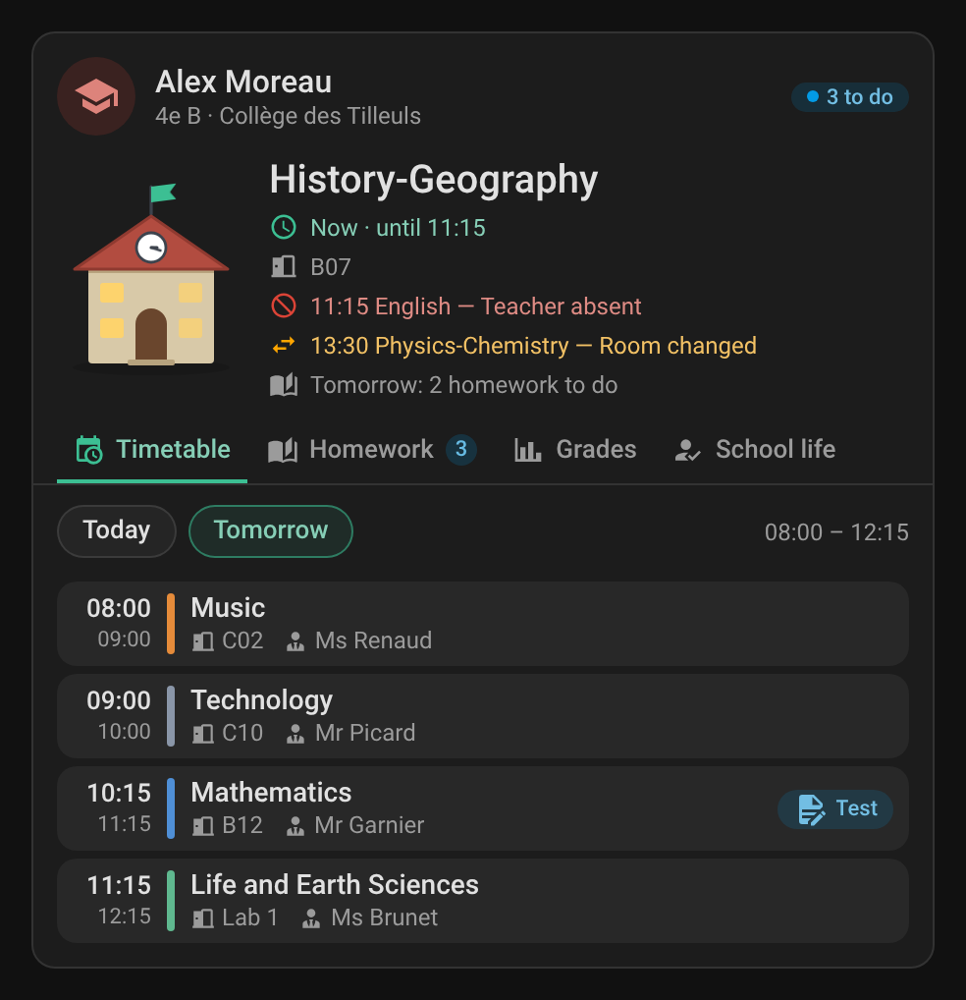 |

### Homework

Grouped by due day, done or to do; a click opens the full text and the attachments at the top of the card:

| Light | Dark |
|---|---|
| 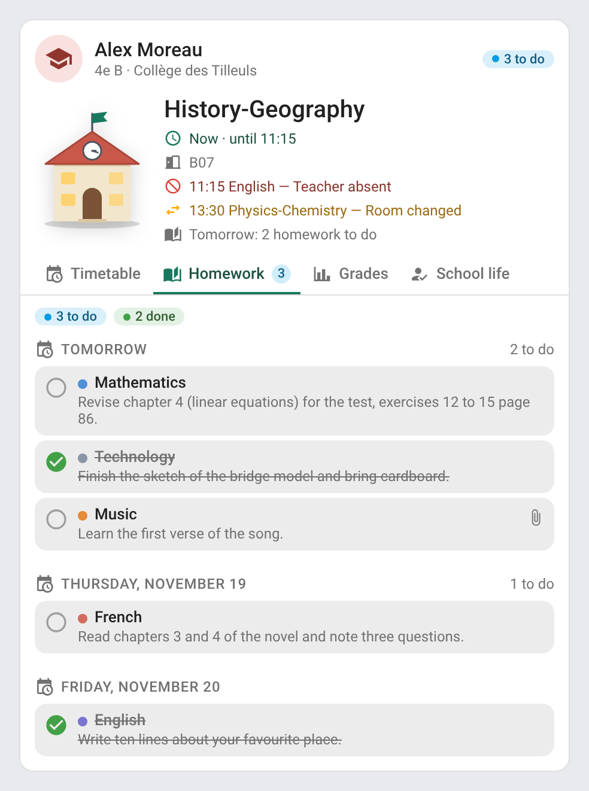 | 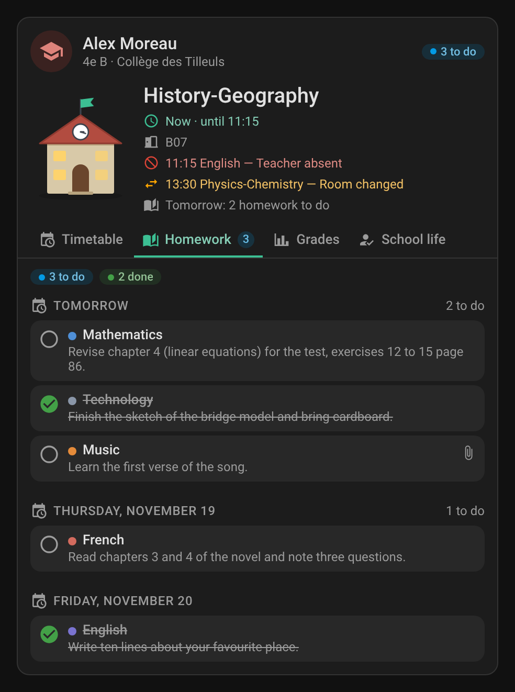 |
| 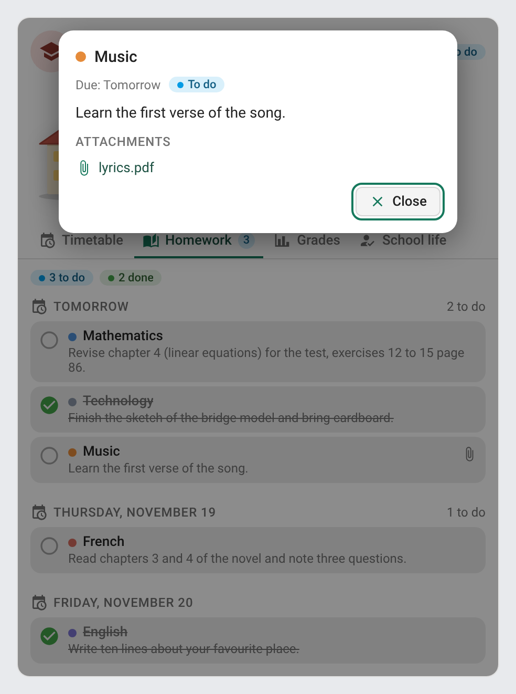 | 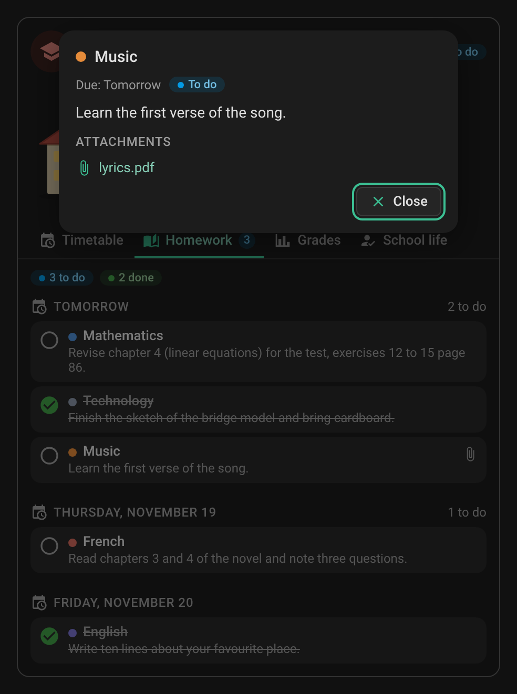 |

### Grades

Overall average of the period, latest grades on their own scale with the class average (green from 14/20, blue from 10, orange from 8, red below), averages per subject with the class marker, evaluations with their acquisition levels:

| Light | Dark |
|---|---|
| 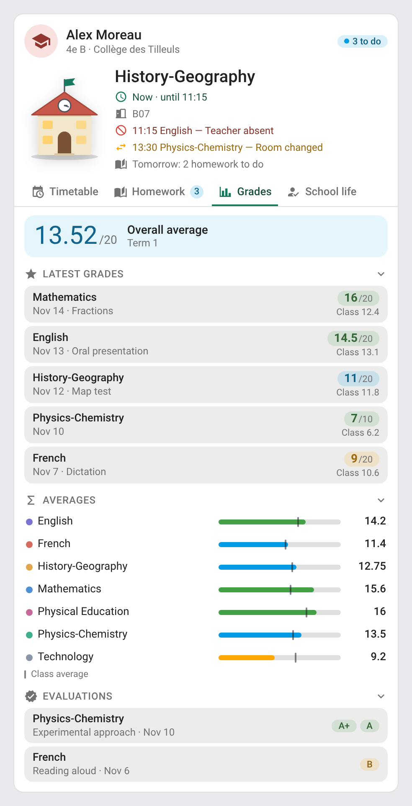 | 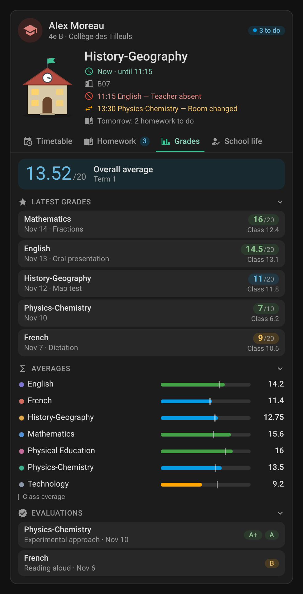 |

### School life

Counters, absences and late arrivals (justified or not), punishments, today's menu and the school's information:

| Light | Dark |
|---|---|
| 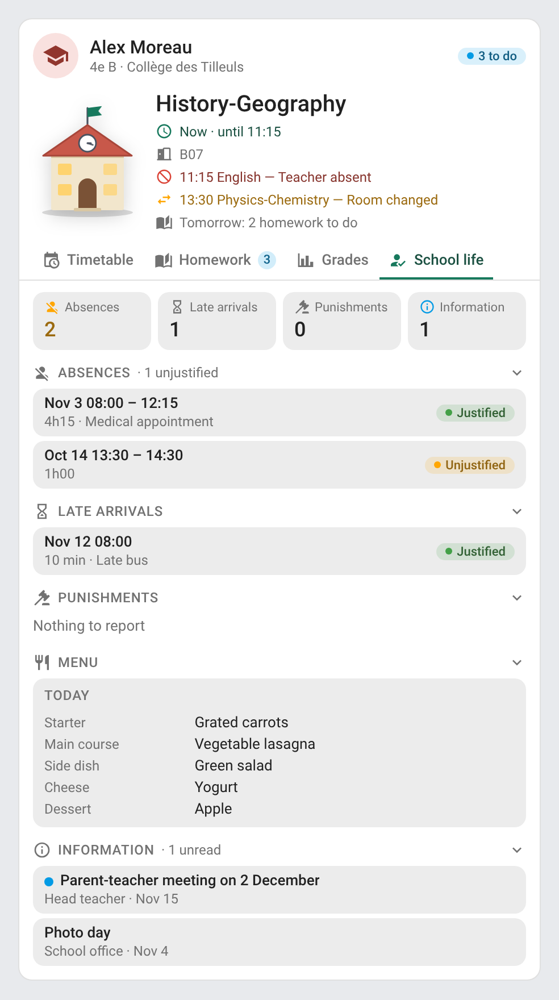 | 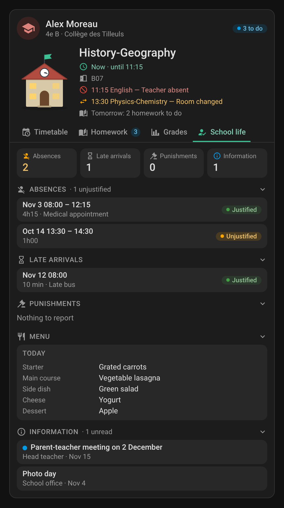 |

### Mini card

The lesson going on or the next one, the changes still to come and the homework for the next school day; with several students, one tab each:

| Light | Dark |
|---|---|
|  |  |
| 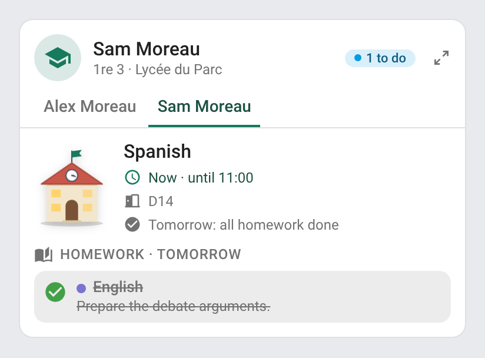 | 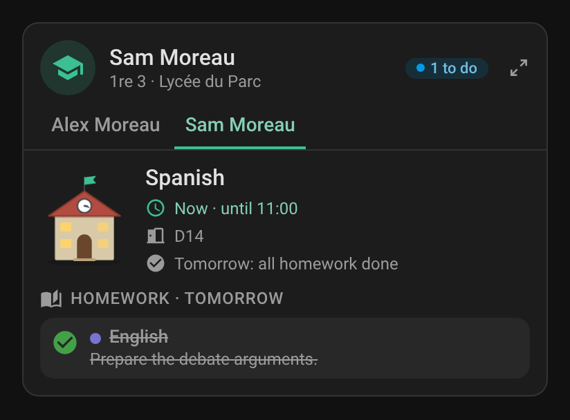 |

### Animations

The picture of the school follows the student's day, on both cards, and settles back to a still picture when nothing is going on. Each state plays its own animation, and every one of them honours `prefers-reduced-motion`.

A lesson is going on: the clock hand turns, the flag waves and the classroom windows glow:

| Light | Dark |
|---|---|
|  | 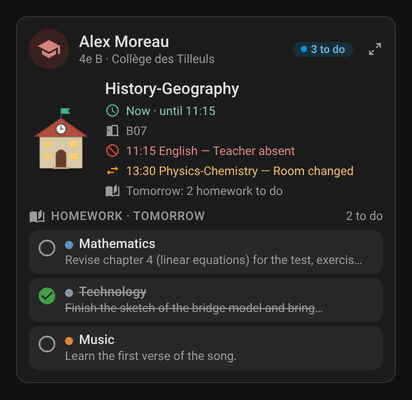 |

A lesson of the day still to come is canceled: a red badge pops up on the school and shakes, the windows go dark:

| Light | Dark |
|---|---|
| 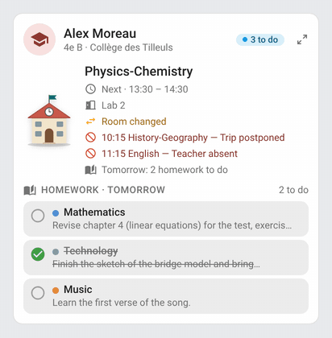 | 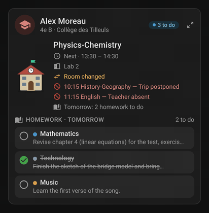 |

The school day is over and homework is still to do for the next one: a pencil writes line after line in the open book:

| Light | Dark |
|---|---|
| 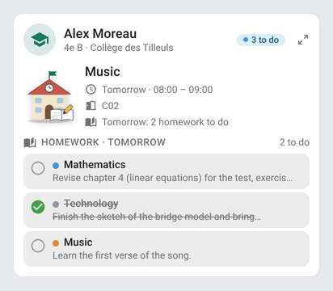 | 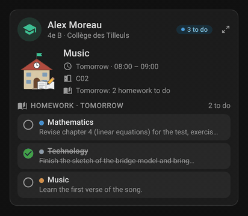 |

All the homework for the next school day is done: a green check is drawn and sparkles twinkle:

| Light | Dark |
|---|---|
| 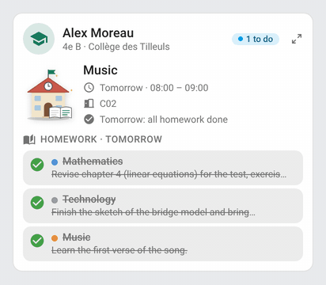 | 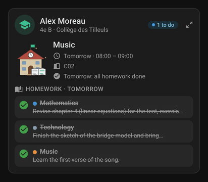 |

## How it works

The cards read the Home Assistant entity and device registries instead of entity ids: every entity of the `pronote` platform is matched by its `translation_key` and grouped by the device it belongs to, one device per student (`Pronote - <name>`). Entity ids can therefore be in any language or renamed without breaking the cards. The lessons, homework, grades and the rest come from the attributes of the sensors, as the integration writes them.

- **Next school day**: the integration's `lessons_next_day` sensor (the next day with lessons, after a weekend or a holiday), else `lessons_tomorrow`. The timetable opens on today while a lesson is still to come, then on the next school day.
- **Canceled and changed lessons**: a lesson Pronote marks as canceled is struck through in red; a lesson that is not canceled but has a Pronote status (room change, replacement, exceptional lesson…) is outlined in orange. The status text is Pronote's own, in the school's language.
- **Picture**: lesson going on → *class*; else a canceled lesson still to come that day → *canceled*; else homework to do for the next school day → *homework*; else all of it done → *done*; else still.
- **Grades** are compared out of 20 whatever their scale; Pronote's decimal comma is read and numbers are written in the card's language. A grade that is not a number (absent, exempted) is shown as Pronote gives it.

## Development

```bash
npm install
npm run build        # bundles src/i18n.js + src/pronote-card.js into dist/pronote-card.js (+ one translation file per language)
npm run check        # builds and checks the card (run in CI)
npm test             # unit tests (node --test)
npm run screenshots  # renders the cards (and one GIF per animated state, needs ffmpeg) with mock data into screenshots/
```

`dist/` is not committed: `npm run build` creates it locally, CI builds it on every push, and the release workflow attaches the built files to the release, which is where the Marketplace installs it from. The screenshots are rendered by the **Screenshots** workflow on every pull request and committed to its branch.

### Releasing

1. Bump `version` in `package.json` (and `package-lock.json`, `npm install`)
2. Add a `## <version>` section at the top of [CHANGELOG.md](https://github.com/juju35/ha-pronote-card/blob/main/CHANGELOG.md)
3. Push to `main`: the **Release** workflow builds the card, creates the tag and the GitHub release with the changelog section as notes, and attaches `pronote-card.js` and its translation files

## Translations

The cards auto-detect the language from your Home Assistant settings. Currently supported:

| Language | Code |
|---|---|
| English | `en` |
| Français | `fr` |
| Deutsch | `de` |
| Español | `es` |
| Српски | `sr` |
| Srpski (latinica) | `sr-Latn` |
| Italiano | `it` |
| Nederlands | `nl` |
| Português (European; also used for `pt-BR`) | `pt` |
| Polski | `pl` |
| Română | `ro` |
| Dansk | `da` |
| Svenska | `sv` |
| Български | `bg` |
| Русский | `ru` |
| Українська | `uk` |
| Magyar | `hu` |
| Slovenčina | `sk` |
| Čeština | `cs` |
| Slovenščina | `sl` |
| Latviešu | `lv` |
| Ελληνικά | `el` |

Contributions for additional languages are welcome!

## Credits

Pronote is a trademark of Index Éducation. This project is not affiliated with Index Éducation nor with the authors of the Pronote integration.

## License

[MIT](https://github.com/juju35/ha-pronote-card/blob/main/LICENSE)

## Support

If you find this project useful, you can support its development:

<a href="https://buymeacoffee.com/julienstep9"></a>
